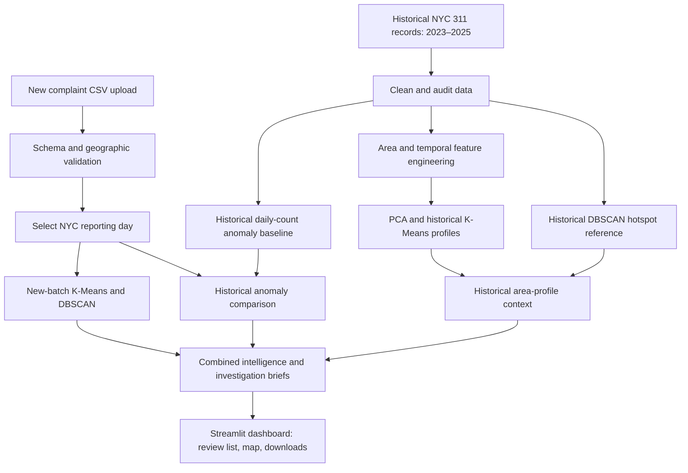
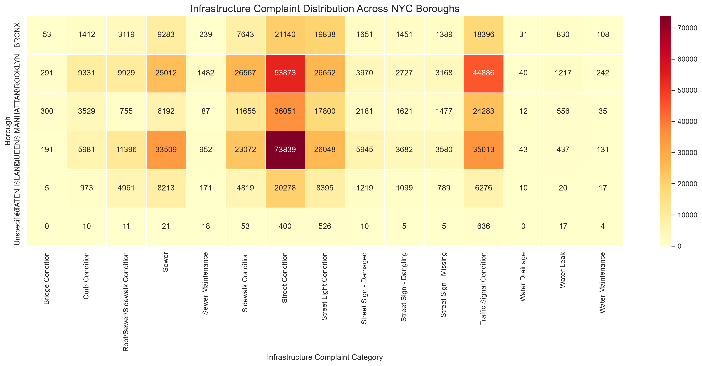
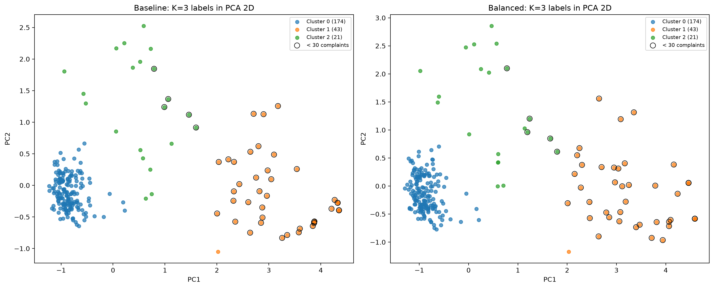

# 🏙️ Urban Infrastructure Pulse Intelligence

**Turning NYC 311 service complaints into geographic insights, unusual-reporting signals, and evidence-based investigation support.**

Urban Infrastructure Pulse Intelligence is an end-to-end Python data science and decision-support project built around **New York City's 311 infrastructure-related service requests**. It brings together data cleaning, exploratory analysis, PCA, K-Means clustering, DBSCAN spatial analysis, historical anomaly screening, geographic validation, and an interactive **Streamlit dashboard**.

The system helps answer three practical questions:

> **Where are infrastructure-related complaints concentrated?**  
> **Which neighborhoods show similar reporting patterns?**  
> **Which new reports deserve a closer look when compared with history?**

It is designed to **support human investigation**, not to verify infrastructure defects, predict emergencies, or automatically decide which repairs should be performed.

**Project repository:** [Drashti2308/urban_intelligent — `audit-cleanup` branch](https://github.com/Drashti2308/urban_intelligent/tree/audit-cleanup)

---

## 📌 Table of contents

1. [Project overview](#-project-overview)
2. [Problem statement](#-problem-statement)
3. [Objectives and key features](#-objectives-and-key-features)
4. [How the system works](#-how-the-system-works)
5. [Machine learning and analytical methods](#-machine-learning-and-analytical-methods)
6. [Dataset and input requirements](#-dataset-and-input-requirements)
7. [Project structure](#-project-structure)
8. [Installation](#-installation)
9. [Run and use the dashboard](#-run-and-use-the-dashboard)
10. [Notebooks and development workflow](#-notebooks-and-development-workflow)
11. [Saved artifacts and outputs](#-saved-artifacts-and-outputs)
12. [Validation and example results](#-validation-and-example-results)
13. [Limitations and responsible interpretation](#-limitations-and-responsible-interpretation)
14. [Future improvements](#-future-improvements)

---

## 📄 Project overview

Urban infrastructure services generate thousands of reports about streets, sidewalks, traffic signals, streetlights, sewer systems, and related public assets. These reports contain useful **location, time, and complaint-category information**, but interpreting them one by one makes it difficult to understand broader geographic or historical patterns.

This project analyzes **15 selected NYC 311 complaint categories** over the **2023–2025 historical study period**. It organizes those records into geographic area features, investigates recurring spatial concentrations, profiles areas with similar complaint mixes, and compares new reporting activity against saved historical references.

The final user-facing component is a **single-page Streamlit application** that accepts new complaint batches, validates their geographic information, runs analytical services, and presents maps, evidence summaries, an investigation review list, and downloadable results.

**Intended audience:** students, researchers, urban data analysts, and teams exploring transparent, data-driven infrastructure-reporting workflows.

### At a glance

| Aspect | Project approach |
|---|---|
| Domain | Urban infrastructure and public-service complaint analytics |
| Historical study data | NYC 311 infrastructure complaints, **2023–2025** |
| Geographic scope | New York City's five boroughs; borough and ZIP Code Tabulation Area (ZCTA) validation |
| Main techniques | PCA, K-Means, DBSCAN, historical daily-count anomaly screening |
| Incoming data | User-uploaded CSV for a selected NYC reporting day |
| Interface | Streamlit + PyDeck interactive maps |
| Main deliverables | Geographic insights, area profiles, spatial candidates, anomaly candidates, investigation explanations, CSV exports |
| Primary app command | `python -m streamlit run dashboard/urban_pulse_simple.py` |

---

## 🎯 Problem statement

**Urban infrastructure complaint data is large, geographically distributed, and difficult to interpret as isolated service requests.** Decision-makers and analysts need a way to move from individual records to an understandable picture of *where* reporting is concentrated, *how* areas differ, and *whether* an incoming batch is unusual relative to historical patterns.

Three challenges motivate this project:

1. **Fragmented geographic evidence:** Nearby complaints may describe a concentrated reporting pattern that is not obvious in a spreadsheet.
2. **Different area-level reporting profiles:** Neighborhoods can have different mixtures of street, lighting, sewer, signal, and other infrastructure complaints; raw counts alone do not explain these differences.
3. **Lack of historical context for new reports:** An incoming cluster of complaints may be noteworthy, but its meaning is clearer when compared with the same area's previous reporting activity and with relevant weekdays or seasons.

### Proposed solution

Build a unified analytical workflow that cleans and checks complaint data, derives area-level features, uses unsupervised learning and historical comparisons to generate **explainable evidence**, and provides an accessible dashboard to help a human reviewer decide what to investigate next.

**Core principle:** A complaint is a report, not a confirmed fault. A concentration or statistical screening flag is a reason to **review evidence**, not proof of damage or a validated maintenance priority.

---

## ⭐ Objectives and key features

- **Reliable data preparation:** Standardize the selected NYC 311 data and retain quality flags for invalid dates, missing fields, and questionable coordinates.
- **Exploratory data analysis:** Examine complaint types, boroughs, monthly trends, seasonal patterns, missingness, and spatial distributions.
- **PCA-based analysis:** Explore high-dimensional area features and support area-profile clustering.
- **K-Means area profiling:** Find neighborhoods with similar complaint-category compositions; display historical profiles only when geographic conditions support the lookup.
- **DBSCAN hotspot intelligence:** Identify and inspect historical spatial complaint concentrations and detect new same-category concentrations in uploaded batches.
- **Historical anomaly screening:** Compare incoming daily reporting with weekday-matched historical references, including seasonal evidence, to highlight unusual increases.
- **Geographic safeguards:** Check borough boundaries and ZIP/ZCTA consistency; make uncertain or rejected records visible rather than silently assigning them to an area.
- **Evidence-led smart assistant:** Combine the model signals into readable investigation briefs and review-order suggestions. This is **rule-based decision support, not a generative-AI chatbot**.
- **Interactive interface and exports:** View an investigation list, explore maps and supporting context, and download audit or analysis outputs.

---

## 🔄 How the system works



The **historical model artifacts remain unchanged** during normal upload processing. New-batch clustering is calculated for eligible incoming data; it does not replace the historical K-Means or DBSCAN models.

### Upload-to-insight sequence

1. Upload a complaint CSV and choose its **NYC reporting day**.
2. Validate required columns, IDs, categories, dates, and coordinates.
3. Process geographic context, including borough and ZIP/ZCTA checks; retain row-level reasons for exclusions.
4. Select eligible records for the chosen reporting day.
5. Analyze **new-batch area similarities**, **new spatial concentrations**, and **historical reporting increases**; add available historical model context.
6. Build an evidence-led investigation review queue, display results on a map, and offer downloadable CSV outputs.

---

## 🧠 Machine learning and analytical methods

| Method | Role in this project | How to interpret its output |
|---|---|---|
| **PCA** | Reduce and visualize correlated area-level features; support historical modeling | A compressed feature representation, **not** a risk score |
| **Historical K-Means** | Group historical geographic areas by reporting-composition patterns | Areas with similar complaint mixes, **not** severity classes |
| **Historical DBSCAN** | Describe spatial concentrations and support lookup against established hotspot references | Geographically associated complaint patterns, **not** verified defects |
| **New-batch K-Means** | Cluster eligible areas in the newly uploaded batch using category shares | Similarities **within that batch**, not retraining of historical profiles |
| **New-batch DBSCAN** | Find same-category spatial concentrations in the selected reporting day | Candidate concentrations requiring review |
| **Anomaly screening** | Compare incoming area/category daily counts with historical weekday and seasonal references | Exploratory unusual-reporting candidates, **not** statistically confirmed anomalies |

### Anomaly detection in particular

The anomaly component is **historical and rule-based**, rather than a fitted scikit-learn anomaly estimator. It uses a saved daily-count reference from **2023–2025**, checks that enough historical evidence exists for an area/category combination, and applies strengthened thresholds to avoid treating every small increase as an anomaly.

The current implementation requires, among other checks, a sufficient incoming count and an increase of **at least three reports and 50% above both relevant historical maxima**. These screening rules are documented and developed in [`notebooks/06_anomaly_detection.ipynb`](notebooks/06_anomaly_detection.ipynb), with the reusable engine in [`src/models/new_batch_anomaly_screen.py`](src/models/new_batch_anomaly_screen.py).

### Historical versus incoming analysis

A key distinction is that **historical profiling** provides saved context, while **new-batch analysis** examines the current uploaded batch. The dashboard combines those two views without silently re-labeling new complaints as confirmed historical events.

---

## 🗃️ Dataset and input requirements

### Historical study data

- **Source material:** NYC 311 service request records filtered to 15 infrastructure-related complaint categories.
- **Coverage:** January 2023 through December 2025.
- **Raw CSV:** [`data/raw/nyc311_all_15_complaints_2023_2025.csv`](data/raw/nyc311_all_15_complaints_2023_2025.csv).
- **Cleaned master:** [`data/processed/nyc311_infrastructure_cleaned.csv`](data/processed/nyc311_infrastructure_cleaned.csv).
- **Geographic subset:** [`data/processed/nyc311_infrastructure_geographic.csv`](data/processed/nyc311_infrastructure_geographic.csv).
- **Quality summary:** [`data/reference/nyc311_data_quality_report.csv`](data/reference/nyc311_data_quality_report.csv).

The raw dataset is retained under `data/raw/`. The redundant copy previously held in the project root was removed during cleanup.

The saved anomaly-baseline manifest documents **685,284 source complaints**, **668,440 eligible historical records**, **238 covered geographic areas**, and **15 supported categories**. These are dataset/reference coverage counts, not measures of model accuracy.

### New complaint batch format

The dashboard accepts a **CSV file** with these columns:

```csv
complaint_id,created_date,latitude,longitude,complaint_category,incident_zip
```

| Field | Meaning | Required? |
|---|---|---|
| `complaint_id` | Unique identifier for each complaint | Yes |
| `created_date` | Complaint date; `YYYY-MM-DD` or supported timestamp with timezone | Yes |
| `latitude` | Complaint coordinate | Yes |
| `longitude` | Complaint coordinate | Yes |
| `complaint_category` | One of the project's supported categories | Yes |
| `incident_zip` | Five-digit ZIP, when supplied | Optional field |

**Upload limits:** maximum **10 MiB** and **5,000 rows** per file. The selected reporting day determines which eligible complaints enter the daily analysis. Unsupported categories, invalid input, and uncertain geography are auditable rather than silently accepted.

Use the provided [`new_complaints_template.csv`](outputs/templates/new_complaints_template.csv), also downloadable from the dashboard. Preserve ZIP values as text to avoid losing leading zeros.

> **Data note:** Downloading the full historical dataset and artifacts may require substantial storage and bandwidth. Some CSV files are stored using **Git LFS**.

---

## 📁 Project structure

The following summarizes the actual [`audit-cleanup` branch](https://github.com/Drashti2308/urban_intelligent/tree/audit-cleanup). Less central generated files are omitted for readability.

```text
urban_intelligent/
├── .streamlit/
│   └── config.toml                      # Dashboard dark theme
├── config/                              # Project configuration
├── dashboard/
│   ├── urban_pulse_simple.py            # FINAL single-page Streamlit app
│   ├── urban_pulse_dashboard.py         # Earlier dashboard implementation
│   ├── urban_pulse_app.py               # Earlier app entry point
│   └── pages/                           # Earlier multi-page interface
├── data/
│   ├── raw/                              # Historical input data
│   ├── processed/                        # Cleaned and engineered datasets
│   └── reference/                        # Data-quality reference files
├── models/
│   ├── dbscan/                           # Historical DBSCAN lookup
│   ├── deployment/                       # Deployed PCA/K-Means bundle
│   ├── geography/                        # Borough and ZCTA geometry
│   ├── hierarchical/                     # Hierarchical research models
│   ├── kmeans/                           # Historical K-Means models
│   ├── pca/                              # PCA models
│   └── preprocessing/                    # Fitted preprocessing artifacts
├── notebooks/
│   ├── 00_reproducibility_validation.ipynb
│   ├── 01_exploratory_data_analysis.ipynb
│   ├── 02_data_preprocessing.ipynb
│   ├── 03_pca_analysis.ipynb
│   ├── 04_kmeans_clustering.ipynb
│   ├── 05_dbscan_spatial_clustering.ipynb
│   ├── 05_hierarchical_clustering.ipynb
│   ├── 06_anomaly_detection.ipynb
│   └── 07_smart_assistant_bulk_intelligence.ipynb
├── outputs/
│   ├── figures/                          # EDA and model visualizations
│   ├── reports/                          # Quality and readiness reports
│   ├── tables/                           # Analysis and reference tables
│   ├── templates/                        # Example upload CSV
│   └── tests/                            # Saved verification artifacts
├── src/
│   ├── data/                              # Data loading utilities
│   ├── features/                          # Temporal and geographic features
│   ├── integration/                       # Bulk and three-model pipelines
│   ├── models/                            # Reusable analytical engines
│   ├── preprocessing/                     # Historical data preparation
│   ├── recommendations/                   # Hotspot/review explanations
│   └── ui/                                # Backend GUI services
├── kmeans_results/                       # Additional K-Means experiment outputs
├── .gitattributes                         # Git LFS configuration for CSV files
├── .gitignore
├── requirements.txt
└── README.md
```

**Note:** The numbered notebooks show the research/development process. The dashboard runs through reusable modules in `src/`; **you do not need to execute every notebook** to use the application. Some historical development cells write files, so do not indiscriminately run all notebook cells on an established installation.

---

## ⚙️ Installation

### Prerequisites

- **Python 3.12** (the validated local environment used Python 3.12).
- **Git** and **Git LFS**, to obtain large tracked datasets.
- Windows PowerShell, macOS, or Linux terminal.
- Enough local disk space for historical CSV datasets, model artifacts, and outputs.

### 1. Clone the validated project branch

```bash
git clone --branch audit-cleanup https://github.com/Drashti2308/urban_intelligent.git
cd urban_intelligent
```

The repository's `audit-cleanup` branch contains the final project organization described here.

### 2. Retrieve Git LFS data

```bash
git lfs install
git lfs pull
```

Without the LFS download, large `.csv` paths may contain only small Git LFS pointer files and the analysis will not have its expected data.

### 3. Create an isolated Python environment

**Windows PowerShell:**

```powershell
py -3.12 -m venv .venv
.\.venv\Scripts\Activate.ps1
```

**macOS / Linux:**

```bash
python3.12 -m venv .venv
source .venv/bin/activate
```

### 4. Install dependencies

```bash
python -m pip install --upgrade pip
python -m pip install -r requirements.txt
```

The project uses **Pandas, NumPy, scikit-learn, Streamlit, PyDeck, GeoPandas, Shapely, Joblib, and Threadpoolctl**. Use **Streamlit 1.36+** for the final app's navigation interface. `requirements.txt` currently lists package names without exact version pins, so a future fresh install may need dependency-version adjustments.

---

## ▶️ Run and use the dashboard

From the **repository root**, run:

```bash
python -m streamlit run dashboard/urban_pulse_simple.py
```

Open the local address shown in the terminal (usually **http://localhost:8501**).

### Typical workflow

1. **Upload:** Download the template or select a complaint CSV.
2. **Choose the day:** Select the NYC reporting date; mark whether the file contains **synthetic/test data**.
3. **Validate:** Review input and geographic validation, including exclusions and backend audit information.
4. **Analyze:** Run the integrated K-Means, DBSCAN, and historical anomaly-screening workflow.
5. **Investigate:** Browse evidence-based review entries and the interactive map.
6. **Download:** Export the available audit and analysis tables for further review.

The final dashboard has **Investigate**, **Map**, and **Downloads** result tabs. It processes uploads in memory; routine analysis does **not overwrite** the stored historical models or baseline.

### Common setup issues

| Problem | What to check |
|---|---|
| Missing data or unreadable CSV | Run `git lfs pull`; confirm the file is not an LFS pointer |
| Missing model or geographic artifacts | Confirm the `models/` and `outputs/tables/` folders were fully obtained |
| Import errors | Run from the repository root and install `requirements.txt` in the active environment |
| CSV rejected | Check exact column names, supported complaint category, date format, and upload limits |
| No findings for a chosen day | Check the selected date and the number of geographically verified eligible rows |

---

## 📓 Notebooks and development workflow

| Notebook | Purpose |
|---|---|
| [`00_reproducibility_validation.ipynb`](notebooks/00_reproducibility_validation.ipynb) | Historical project and dataset reproducibility checks |
| [`01_exploratory_data_analysis.ipynb`](notebooks/01_exploratory_data_analysis.ipynb) | Complaint distributions, trends, geographic EDA |
| [`02_data_preprocessing.ipynb`](notebooks/02_data_preprocessing.ipynb) | Data quality, cleaning, preprocessing exploration |
| [`03_pca_analysis.ipynb`](notebooks/03_pca_analysis.ipynb) | Dimensionality-reduction analysis |
| [`04_kmeans_clustering.ipynb`](notebooks/04_kmeans_clustering.ipynb) | Historical area clustering and profile development |
| [`05_dbscan_spatial_clustering.ipynb`](notebooks/05_dbscan_spatial_clustering.ipynb) | Historical spatial clustering and hotspot research |
| [`05_hierarchical_clustering.ipynb`](notebooks/05_hierarchical_clustering.ipynb) | Hierarchical-clustering research comparison |
| [`06_anomaly_detection.ipynb`](notebooks/06_anomaly_detection.ipynb) | Historical baseline construction, anomaly rules, tests, reusable engine development |
| [`07_smart_assistant_bulk_intelligence.ipynb`](notebooks/07_smart_assistant_bulk_intelligence.ipynb) | Bulk complaints and integration of analytical results with investigation/GUI services |

### Selected reusable Python entry points

- [`src/preprocessing/clean_full_nyc311.py`](src/preprocessing/clean_full_nyc311.py) — historical cleaning; can be run explicitly with `python -m src.preprocessing.clean_full_nyc311` **only if you intend to regenerate processed data**.
- [`src/models/dbscan_predictor.py`](src/models/dbscan_predictor.py) — historical DBSCAN association.
- [`src/integration/kmeans_area_lookup.py`](src/integration/kmeans_area_lookup.py) — historical K-Means area profiles.
- [`src/models/new_batch_area_kmeans.py`](src/models/new_batch_area_kmeans.py) — incoming area clustering.
- [`src/models/new_batch_dbscan.py`](src/models/new_batch_dbscan.py) — incoming spatial concentration analysis.
- [`src/models/new_batch_anomaly_screen.py`](src/models/new_batch_anomaly_screen.py) — historical anomaly-screening engine.
- [`src/integration/live_uploaded_batch_pipeline.py`](src/integration/live_uploaded_batch_pipeline.py) — validated CSV-to-dashboard orchestration.
- [`src/integration/investigation_review_queue.py`](src/integration/investigation_review_queue.py) — interpretable review-order suggestions.

---

## 📊 Saved artifacts and outputs

| Location | Contents |
|---|---|
| `data/processed/` | Cleaned and derived historical complaint datasets |
| `models/kmeans/`, `models/pca/`, `models/deployment/` | Fitted historical area-profile and dimensionality-reduction artifacts |
| `models/dbscan/` | Historical DBSCAN core lookup |
| `models/geography/` | NYC borough and ZCTA reference polygons |
| [`outputs/tables/anomaly/`](outputs/tables/anomaly/) | Historical daily-count snapshot and manifest |
| [`outputs/tables/dbscan/`](outputs/tables/dbscan/) | Hotspot profiles, recurrence, recommendations, and supporting tables |
| [`outputs/tables/kmeans/`](outputs/tables/kmeans/) | Area/cluster profiles and quality checks |
| [`outputs/figures/`](outputs/figures/) | EDA, PCA, clustering, and comparison graphics |
| [`outputs/reports/final_validation/`](outputs/reports/final_validation/) | Project-readiness report and validation manifest |
| [`outputs/templates/`](outputs/templates/) | Six-column complaint upload template |
| `outputs/tests/` | Saved experiment and pipeline test artifacts |

### Core files expected by the application

The dashboard's backend checks for the following historical resources before starting its geographic and model services:

```text
models/dbscan/primary_f_core_lookup_v1.joblib
models/geography/nyc_borough_boundaries_gthc-hcne_v1.geojson
models/geography/nyc_zcta_35j5-n34v_snapshot_2026_v1.geojson
outputs/tables/dbscan/                         # Historical hotspot tables
outputs/tables/dbscan/dbscan_action_taxonomy_v1.csv
outputs/tables/kmeans/kmeans_full_data_k3_descriptive_profiles.csv
```

The incoming anomaly workflow additionally loads:

```text
outputs/tables/anomaly/historical_daily_counts_2023_2025_v1.csv.gz
outputs/tables/anomaly/historical_daily_counts_2023_2025_v1_manifest.json
```

Keep those saved assets alongside the code; launching the dashboard is **not** a substitute for rebuilding the historical training notebooks.

### Examples of generated analysis figures

**NYC complaint categories by borough**



**Historical K-Means area clusters in PCA space**



---

## ✅ Validation and example results

The saved [project-readiness report](outputs/reports/final_validation/project_readiness_report.md) documents an earlier historical-backend validation snapshot:

| Historical validation metric | Recorded result |
|---|---:|
| Historical K-Means areas | **238** |
| Historical K-Means profile groups | **3** |
| Historical DBSCAN hotspots | **2,846** |
| Complaint records associated with historical DBSCAN clusters | **317,936** |
| Automated application/backend consistency checks | **247 / 247 passed** |

These are **saved research and integration checks**, not independent estimates of predictive accuracy, infrastructure defects, or live service quality.

A later **synthetic 500-complaint integration test**, run after the notebook reorganization, reported:

| Synthetic example metric | Result |
|---|---:|
| Uploaded / selected complaints | **500** |
| New-batch K-Means assignments | **500** |
| New-batch DBSCAN candidate concentrations | **23** |
| Complaints associated with those spatial candidates | **228** |
| Anomaly candidate area/category groups | **10** |
| Complaints associated with those anomaly candidates | **139** |

The DBSCAN and anomaly counts describe **different, possibly overlapping sets**; do not add their complaint counts together. The example uses synthetic data, so these results should not be interpreted as actual NYC incidents or real-world model accuracy.

The project has also been launched successfully in a fresh Python 3.12 environment and the final Streamlit GUI was manually exercised locally. **Production deployment and independent operational acceptance are not established.**

---

## ⚠️ Limitations and responsible interpretation

- **Complaint reporting is not ground truth:** Repeat reports do not prove multiple defects, and closure dates do not necessarily equal repair completion dates.
- **Models describe patterns, not infrastructure condition:** PCA/K-Means area profiles, DBSCAN concentrations, and anomaly flags are exploratory evidence, not fault severity, risk probabilities, or emergency priorities.
- **Historical coverage is limited:** References are based on **2023–2025** data and selected infrastructure categories; historical behavior may differ from future reporting.
- **Geographic uncertainty matters:** Incorrect coordinates, unknown ZIP/ZCTA relationships, or boundary ambiguity can restrict or exclude area-based interpretation.
- **Anomaly detection is a screening heuristic:** Its thresholds are interpretable rules, not proof of statistical significance or causality.
- **No live feed or autonomous dispatch:** The application analyzes uploaded CSV batches; it does not implement live NYC 311 ingestion, automatic work orders, or validated repair scheduling.
- **Demo/research readiness is not production readiness:** Authentication, privacy review, monitoring, security hardening, scaling, and independent field validation would be needed for operational deployment.

**Use the output to guide a human review of underlying records and operational evidence—not as an automated maintenance or public-safety decision.**

---

## 🔮 Future improvements

- Add a documented, scheduled method for refreshing historical reference datasets and monitoring changing reporting patterns.
- Evaluate cluster and anomaly stability on separate real-world temporal holdout periods.
- Incorporate verified maintenance outcomes, where available, to assess whether screening signals support useful decisions.
- Add application authentication, audit logging, deployment monitoring, and performance tests for larger workloads.
- Improve geographic reference updates and uncertainty explanations.
- Pin dependency versions and add repeatable CI tests for all supported environments.

---

## 📚 Data, repository, and reuse notes

- **Project:** [Urban Infrastructure Pulse Intelligence](https://github.com/Drashti2308/urban_intelligent/tree/audit-cleanup)
- **Data context:** New York City 311 service-request records; consult the original data provider for current data-access and reuse terms.
- **License:** No `LICENSE` file was present in the inspected `audit-cleanup` branch. Do not assume an MIT or other open-source license without one being explicitly added.

---

**Urban Infrastructure Pulse Intelligence — from raw civic complaint records to transparent, map-based investigation evidence.**
